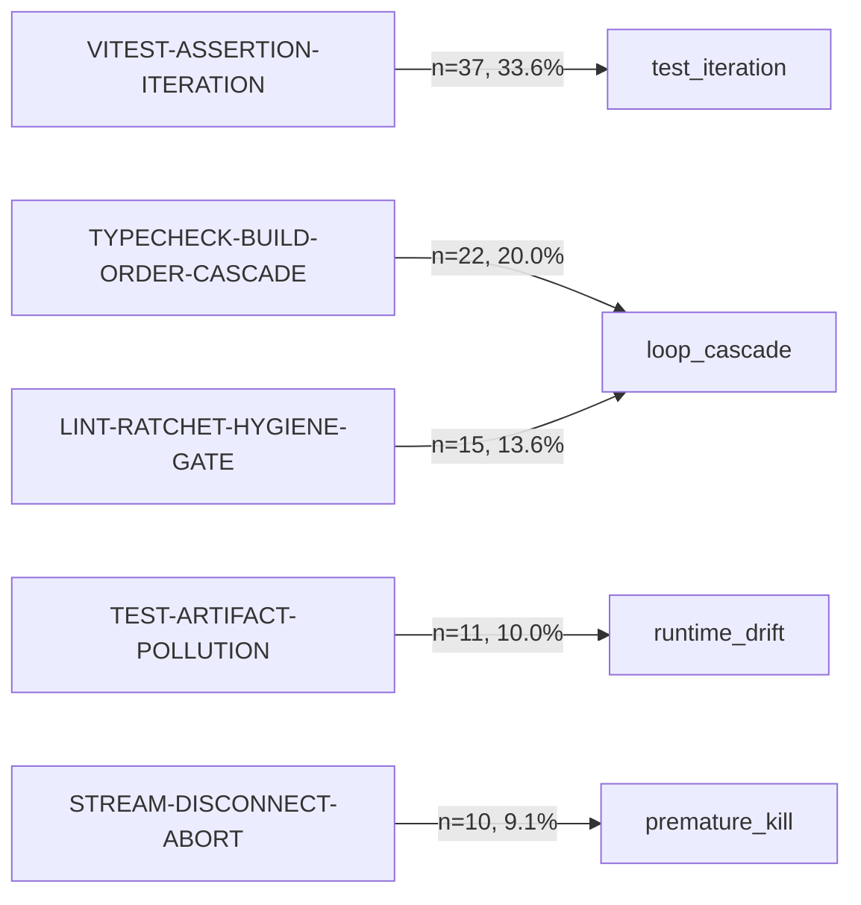

# reval — TideOS Eval Kit (Tool 1)

> **Deterministic evaluation, trace error analysis, causal failure graphs, and fail-closed quality gating for autonomous AI agent harnesses and software factories.**

[](https://github.com/TechTideOhio/reval/actions/workflows/ci.yml)
[](LICENSE)
[](Cargo.toml)

Part of **TideOS** by [TechTide AI](https://techtideai.io).

---

## Why reval?

Most AI evaluation frameworks rely on LLM-as-a-judge prompts that suffer from non-determinism, model drift, token costs, and prompt injection vulnerabilities. When an agent breaks a build loop or leaks an API credential, an LLM judge cannot be trusted to fail closed in CI.

`reval` implements the empirical evaluation methodology codified by Hamel Husain, Shreya Shankar, and Anthropic/OpenAI research:

> *"Start with error analysis, not metrics. Sample 100+ production traces. Annotate each failure in free text (open coding), then cluster them into failure categories (axial coding). Count frequency per category. Your top 3 categories are your first metrics."*

`reval` is a single, zero-dependency, pure-Rust CLI tool with no `-sys` C libraries, no external Python runtimes, and no LLM API calls in the verification path. It evaluates agent runs deterministically in milliseconds.

---

## Core Capabilities (Architected for Real Agent Engineers)

### 1. Poltergeist-Style Loop Watcher (Steinberger-Ready)
Autonomous CLI agents running in parallel grids can spiral into infinite repair loops. `reval watch` runs an active polling daemon over harness logs and terminal sessions. The instant a loop cascade or circuit breaker is breached, it sounds an audible terminal bell (`\x07`) and prints an immediate high-visibility alert:

```bash
reval watch --root . --interval-ms 800
```

```text
🔭 reval watcher active (root: ., poll: 800ms)
Watching for agent runs and monitoring loop cascades... (Ctrl+C to stop)

✅ [2026-10-30T14-24-53-cargo-fmt] cargo fmt (agent: q.mjs)
❌ [2026-10-30T11-59-45-pnpm-build] pnpm build (agent: vsp)

🚨 ==================== [ALARM: RUNAWAY LOOP CASCADE] ====================
Trace: 2026-10-30T11-59-45-pnpm-build
Open code: TYPECHECK-BUILD-ORDER-CASCADE
Axial category: loop_cascade
Diagnostic: error TS2307: Cannot find module '@vsp/contracts'
Remediation: Rebuild upstream @vsp/contracts + regenerate types before downstream typecheck; halt immediately on q.mjs exit 3.
=========================================================================
```

### 2. Native Model Context Protocol (MCP) Server
Claude Code, Codex, and Cursor can run `reval` directly in-session via standard stdio JSON-RPC without subshell gymnastics:

```bash
reval mcp --root .
```

- **Tools**: `reval_check_gate`, `reval_analyze_traces`, `reval_get_lessons`, `reval_repo_hygiene`.
- **Resources**: `reval://metrics/top3`, `reval://graph/causal`, `reval://lessons/latest`.

### 3. Causal Failure Transition Graph (Sweet / `orneryd`-Ready)
Instead of treating failure modes as flat static buckets, `reval trace graph` constructs a directed causal graph (Graph-RAG style) linking open-code precursor warnings (e.g., `LINT-RATCHET`, `STREAM-DISCONNECT`) to downstream cascade events (`loop_cascade`, `premature_kill`):

```bash
reval trace graph --format mermaid
```



### 4. Proactive Lessons Learned for Agent Memory (Mimir / NornicDB)
Before an agent attempts a task, it can query historical lessons learned from past failures to avoid known monorepo traps:

```bash
reval trace lessons vitest
```

```text
=== REVAL PROACTIVE LESSONS (query: Some("vitest")) ===
#1. [VITEST-ASSERTION-ITERATION] -> [test_iteration] (n=37, 33.6% risk)
   Rule: Run narrowest single test file while iterating; isolate Postgres advisory-lock fixtures per test.
```

### 5. Execution Trace Tree & Visual Dashboard (Chase / LangSmith-Ready)
`reval trace tree` aggregates multi-agent trajectories into an interactive, self-contained HTML dashboard with search filtering, collapsible nodes, and error badges:

```bash
reval trace tree --html Tools/reval/fixtures/tree.html
```

### 6. Hybrid Evaluation (Code Heuristics + Model-Graded Evaluators)
Golden test suites (`reval eval suite`) support `Check::HybridJudge`, combining deterministic regex and exit-code validation with optional external model-graded rubric scripts, failing closed if the evaluator exits non-zero.

---

## 60-Second Quickstart

### Build from Source

```bash
# Clone and build release binary
cargo build --manifest-path Tools/reval/Cargo.toml --release

# On Windows PowerShell, use the helper wrapper:
.\Tools\reval\reval.ps1 --help
```

### Trace Error Analysis (Husain/Shankar Pipeline)

```bash
reval trace analyze --root .
```

Output:
```text
=== REVAL ERROR ANALYSIS REPORT (n=459 traces, sha256=54256d4e169b...) ===
Reliability: pass=349 fail=110 | pass@1=76.0% | pass@3=98.6% | pass^3=44.0%

--- TOP 3 AXIAL CATEGORIES (YOUR FIRST 3 METRICS) ---
#1 [loop_cascade] Monorepo Build-Order & Gate Loop Cascades: 37 failures (33.6%) -> metric `loop_cascade_rate`
   Open codes: LINT-RATCHET-HYGIENE-GATE, TYPECHECK-BUILD-ORDER-CASCADE
   Fix hint:   Rebuild upstream @vsp/contracts + regenerate types before downstream typecheck; halt immediately on q.mjs exit 3.
#2 [test_iteration] Unit/Integration Assertion & Concurrency Test Iteration: 37 failures (33.6%) -> metric `test_iteration_rate`
   Open codes: VITEST-ASSERTION-ITERATION
   Fix hint:   Run narrowest single test file while iterating; isolate Postgres advisory-lock fixtures per test.
#3 [runtime_drift] Agent Binary, Self-Update Stub & Model Catalog Drift: 15 failures (13.6%) -> metric `runtime_drift_rate`
   Open codes: BINARY-SELF-UPDATE-STUB, ENV-PATH-SANDBOX, MODEL-CATALOG-MISMATCH, TEST-ARTIFACT-POLLUTION
   Fix hint:   Resolve native claude.exe (>4KB) and desktop codex.exe directly; isolate test runs via HARNESS_RUNS_DIR.

--- COMPUTED FIRST 3 METRICS ---
1. loop_cascade_rate_pct   = 15.9% (loop_guard_breach_count = 10)
2. runtime_drift_rate_pct  = 6.6%
3. premature_kill_rate_pct = 4.9%
```

### Fail-Closed Quality Gate

```bash
reval gate \
  --corpus Tools/reval/fixtures/traces.jsonl \
  --baseline Tools/reval/fixtures/baseline.json \
  --write-proof Tools/reval/fixtures/proof.json
```

Output:
```text
PASS: all 6 axial metric gates passed (proof_sha256=66dee7210f9f...)
  [PASS] loop_cascade_rate_pct      observed=15.9     <= threshold=20
  [PASS] loop_guard_breach_count    observed=10       <= threshold=10
  [PASS] runtime_drift_rate_pct     observed=6.6      <= threshold=8
  [PASS] premature_kill_rate_pct    observed=4.9      <= threshold=5
  [PASS] pass_at_1                  observed=0.7603   >= threshold=0.75
  [PASS] pass_at_3                  observed=0.9862   >= threshold=0.98
```

---

## Machine-Readable JSON Envelope

Every subcommand supports `--json` to output TechTide's canonical multi-agent envelope:

```json
{
  "status": "success",
  "summary": "PASS: all 6 axial metric gates passed (proof_sha256=66dee7210f9f...)",
  "next_actions": ["commit proof bundle if corpus updated"],
  "artifacts": ["Tools/reval/fixtures/baseline.json"],
  "data": { ... }
}
```

---

## Architecture

```text
Tools/reval/
├── Cargo.toml               # Rust 2024 edition, pure Rust dependencies
├── .cargo/config.toml       # Lints, target optimizations
├── .github/workflows/ci.yml # Pinned SHA multi-platform CI
├── reval.ps1                # PowerShell wrapper
├── fixtures/                # Calibrated traces, baselines, proofs & dashboard
└── src/
    ├── main.rs              # CLI parser (clap derive)
    ├── lib.rs               # Library root export
    ├── error.rs             # RevalError domain error enum
    ├── envelope.rs          # HarnessEnvelope JSON protocol schema
    ├── watch/               # Active Poltergeist-style loop watcher
    ├── mcp/                 # Native Model Context Protocol (MCP) server
    ├── tree/                # Hierarchical trace tree & HTML exporter
    ├── ingest/              # Corpus ingestion & regex secret redaction
    │   ├── golang.rs        # `go test -json` streaming parser
    │   ├── rust.rs          # `cargo test/clippy` JSON event parser
    │   └── harness.rs       # Multi-agent prompt/stdout/result loader
    ├── coding/              # Husain/Shankar qualitative coding
    │   ├── open.rs          # Free-text failure annotation
    │   ├── axial.rs         # Clustering into 6 axial categories
    │   ├── top3.rs          # Ranking and Top 3 metric derivation
    │   ├── causal.rs        # Directed Causal Failure Transition Graph
    │   └── lessons.rs       # Proactive agent memory query engine
    ├── eval/                # Stratified golden test evaluation
    │   ├── checks.rs        # Deterministic regex, json, & hybrid judge checks
    │   ├── rubric.rs        # Blocker veto weighting & scoring
    │   └── stratum.rs       # Stratified score combination
    ├── gate/                # Continuous quality gating
    │   ├── reliability.rs   # Pass@1, Pass@3, Pass^3 calculation
    │   ├── ratchet.rs       # baseline.json threshold validator
    │   └── proof.rs         # Canonical JSON SHA-256 signed proof generator
    └── hygiene/             # Static repo health checks
        └── checks.rs        # .env leaks, lockfile conflicts, dangling skills
```

---

## Verification & Test Gates

Run the test suite and release build through TechTide's quiet runner:

```bash
# Formatting
node Tools/agent-harness/q.mjs -- cargo fmt --manifest-path Tools/reval/Cargo.toml --all -- --check

# Clippy lints (warnings treated as errors)
node Tools/agent-harness/q.mjs -- cargo clippy --manifest-path Tools/reval/Cargo.toml --all-targets -- -D warnings

# Integration and property test suite (950+ randomized property iterations)
node Tools/agent-harness/q.mjs -- cargo test --manifest-path Tools/reval/Cargo.toml --all-targets

# Release build
node Tools/agent-harness/q.mjs -- cargo build --manifest-path Tools/reval/Cargo.toml --release
```

---

## License

MIT © [TechTide AI](https://techtideai.io) & Alexi5000.
